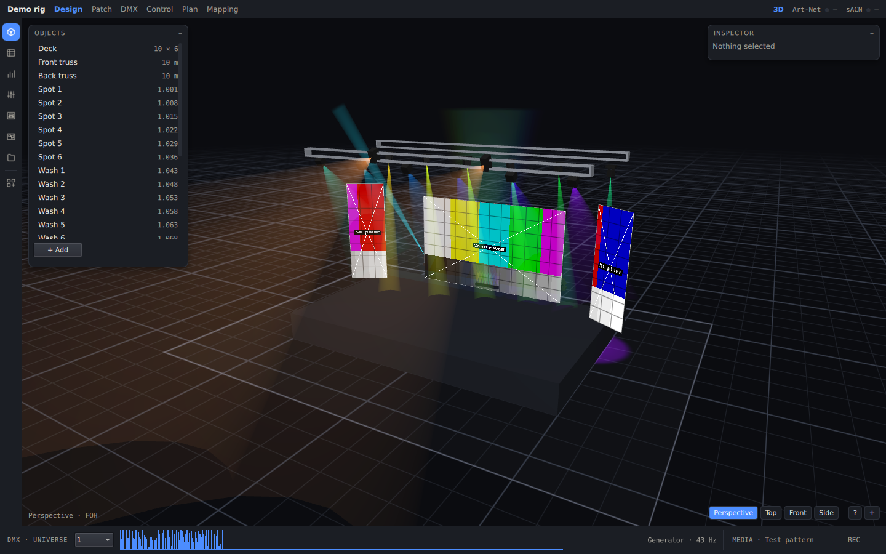

**English** · [Polski](README.pl.md)

# Scene Visualiser

A desktop previsualiser for stage lighting and LED walls. Build the rig, patch it, point your console at it over
Art-Net or sACN, and watch beams and video walls respond in real time, in the spirit of Capture.

## Features

- **Live DMX in:** Art-Net 4 and sACN (E1.31) with priority, per-address priority and sync. Up to 64 universes are
  merged by HTP, LTP or priority.
- **Real fixtures:** GDTF files, including multi-head and pixel fixtures. A built-in editor creates simple fixture
  types.
- **GPU beams and walls:** volumetric beams with haze, floor pools, gobos and colour wheels. LED walls, string walls
  and pixel strips.
- **Video:** test patterns, stills, video files, screen and window capture, NDI, Spout and Syphon. Resolume Arena
  Advanced Output presets round-trip.
- **Interchange:** MVR, CSV, OBJ, FBX and glTF in, MVR, FBX, OBJ, grandMA3 patch and CSV out.
- **Paperwork:** plan, front and side drawings with dimensions, legend and title block, exported to PDF or SVG.
- **Show tools:** a programmer with groups and looks, DMX and video recording and playback, timecode chase, and DMX
  output to drive the real rig.
- **AI access:** a built-in MCP server lets an AI assistant inspect and edit the scene.

## Download

Installers are on the [Releases](../../releases) page:

| Platform | File |
|---|---|
| Windows 10/11 (x64) | `SceneVisualiser-windows.msi` (or `.zip`, no install) |
| macOS 13+ (Apple Silicon and Intel) | `SceneVisualiser-macos.dmg` |
| Linux | build from source, see [docs/building.md](docs/building.md) |

## Quick start

1. Install and launch. The app opens a demo rig.
2. Send DMX from your console or software to this computer: Art-Net universe 0:0:0 or sACN universe 1. The title-bar
   Art-Net/sACN light turns green.
3. Open **Patch** to see where each fixture listens, and re-address it to match your show file.
4. Open **Design** to move things around: the Objects card on the left, the Inspector on the right.
5. Save with Ctrl+S (Cmd+S). The project is a single `.svproj` file.

## Documentation

| | English | Polski |
|---|---|---|
| Getting started | [getting-started](docs/en/getting-started.md) | [pierwsze kroki](docs/pl/getting-started.md) |
| Building a rig | [building-a-rig](docs/en/building-a-rig.md) | [budowa sceny](docs/pl/building-a-rig.md) |
| DMX and patch | [dmx-and-patch](docs/en/dmx-and-patch.md) | [DMX i patch](docs/pl/dmx-and-patch.md) |
| Video and mapping | [video-and-mapping](docs/en/video-and-mapping.md) | [wideo i mapowanie](docs/pl/video-and-mapping.md) |
| Import and export | [import-export](docs/en/import-export.md) | [import i eksport](docs/pl/import-export.md) |
| AI access (MCP) | [ai-access](docs/en/ai-access.md) | [dostęp AI](docs/pl/ai-access.md) |
| Building from source | [building](docs/building.md) | |

## Licence

LGPL-3.0-or-later (see [COPYING.LESSER](COPYING.LESSER) and [COPYING](COPYING)). It uses Qt under the LGPL v3,
linked dynamically.

Version 0.3.0 (Beta).
