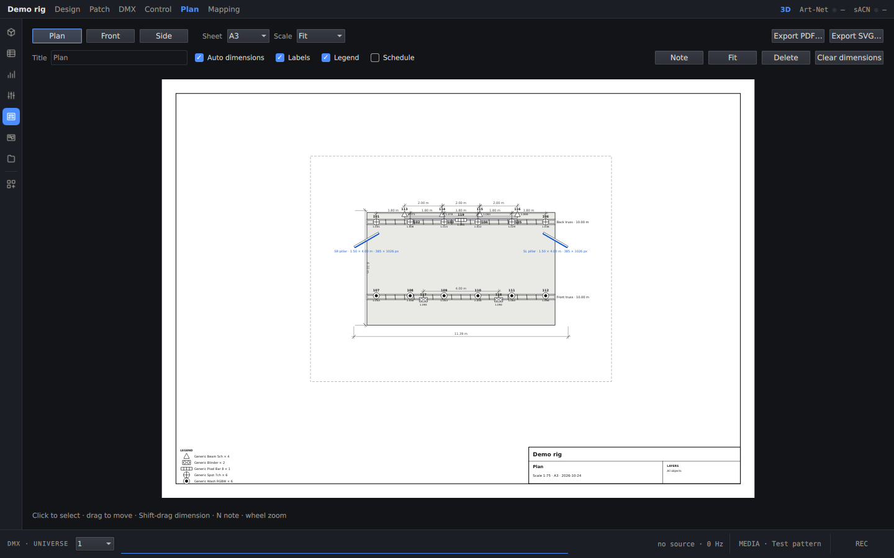

**English** · [Polski](../pl/import-export.md) · [Docs home](../../README.md#documentation)

# Import and export

Imports and exports are under **IMPORT** and **EXPORT** on the Project screen. You can also drop a file on the
window: `.svproj`, `.gdtf`, `.mvr`, `.obj`, `.fbx` or `.xml` (Resolume).

## Formats

| Format | Import | Export | Notes |
|---|---|---|---|
| MVR 1.6 | ✓ | ✓ | Fixtures, LED walls, trusses, groups and set geometry. Import merges into the open project. |
| CSV | ✓ | ✓ (patch) | A dialog maps the columns. Matching fixture IDs are updated, the rest are added. |
| OBJ (+ MTL) | ✓ | ✓ | Static set pieces, with material colours. Choose the unit and Z-up when importing, and optionally split groups. Export all or only the selection. |
| FBX | ✓ | ✓ | Meshes keep their hierarchy. Export adds LED-wall screens and cameras, for Blender, Unreal or C4D. |
| glTF / GLB | ✓ (in MVR) | ✓ (in MVR) | |
| grandMA3 patch | | ✓ | A fixture XML for MA3 |
| Resolume preset | ✓ | ✓ | See [Video and mapping](video-and-mapping.md) |

The units and up-axis are converted on import. The app works in metres with Y up.

## Drawings

The **Plan** screen draws plan, front and side views on A3 or A4 paper, with:
- fixture symbols by type, and labels;
- automatic dimensions (stage size, fixture spacing, truss trims);
- a legend with counts, an optional fixture schedule, and a title block.

To edit the sheet:
- Shift-drag adds a dimension.
- **N** places a note. Double-click a note to edit its text.
- Drag fixtures to move them in the rig.

**Export PDF** and **Export SVG** write the sheet.

## Show recording

Click **REC** in the dock to record. It saves:
- every incoming universe to a `.svdmx` file;
- the composition video, and each live output feed, to `.mp4` files when a live source is running.

**Playback** replays the take. It can loop, or follow Art-Net timecode with an offset. You can choose which fixtures,
groups or outputs play the recording and which stay live, and crossfade between the two. Recordings are kept next to
the project, not inside it.

Next: [AI access](ai-access.md)
