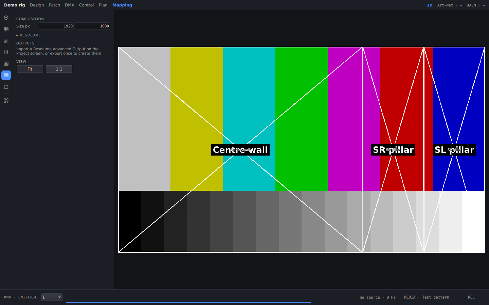

**English** · [Polski](../pl/video-and-mapping.md) · [Docs home](../../README.md#documentation)

# Video and mapping

LED walls show a **composition**: one image that each wall samples through its own slice.

## Composition source

Click **MEDIA** in the dock to choose the source:

| Source | Notes |
|---|---|
| Test pattern / Grid | built in; the grid prints coordinates for checking a mapping |
| Still | an image, placed with fit, fill or stretch |
| Video | a video file, looped. Files up to 200 MB are copied into the project. Larger ones are linked. |
| Screen / Window | capture a display or one application window |
| NDI | any NDI sender on the network. It needs the free [NDI runtime](https://ndi.video/tools/) installed. |
| Spout (Windows) / Syphon (macOS) | a GPU texture shared by another app |

The Media card shows the size, frame rate and latency.

## Mapping screen

The composition is drawn with every wall's slice on top. Drag a slice to move it, or type exact pixel values in the
Inspector.

## Resolume Arena

- **Import:** use **Project → IMPORT → Resolume screens…** (or drop the `.xml`) to open an Arena *Advanced Output*
  preset. It creates the outputs, LED walls and pixel strips, and sizes the composition.
  - With **Place from composition**, the walls are laid out from their slices at the given LED pitch (`pitch mm`).
  - A wall whose name matches an existing wall updates that wall.
- **Export:** **Resolume output…** writes the preset back. Settings the app does not use are kept exactly as they
  were, so Arena reads them unchanged.
- **Send to Resolume:** saves the preset straight into `Documents/Resolume Arena/Presets/Advanced Output/`.
- **Per-output feeds:** Arena can send one NDI stream per output screen. **Connect NDI** in the Media card matches them
  by name, so each wall shows exactly what Arena sends to its output.

## Pixel strips and string walls

- **Pixel strip:** an LED strip driven either by DMX (pixel by pixel, across universes if needed) or by a slice of the
  composition.
- **String wall:** an LED wall made of polylines. Its **Facing** setting makes it glow towards one side or all of them.

Next: [Import and export](import-export.md)
