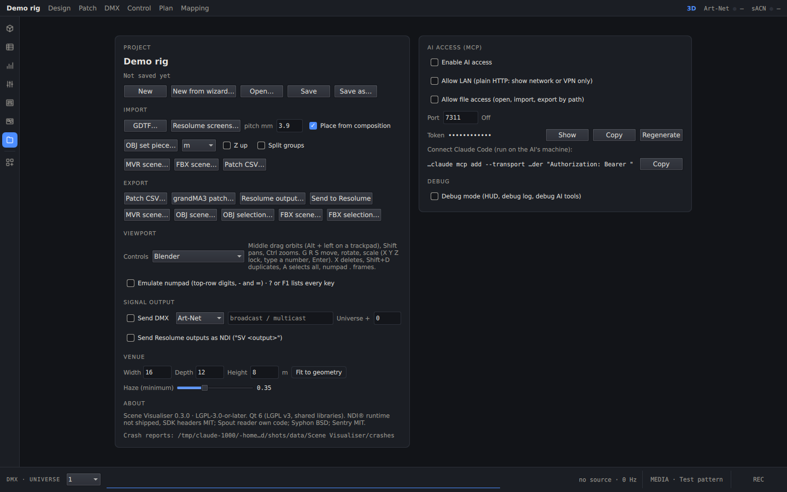

[English](../en/ai-access.md) · **Polski** · [Spis treści](../../README.pl.md#dokumentacja)

# Dostęp AI (MCP)

Scene Visualiser ma wbudowany serwer [Model Context Protocol](https://modelcontextprotocol.io). Dzięki niemu asystent
AI, na przykład Claude, może oglądać scenę i ją zmieniać: dodawać oprawy, budować ściany, zmieniać patch, ustawiać
światło, robić zrzuty ekranu. Każda zmiana AI to jeden krok cofania, opisany `AI: …`.

## Włączanie



1. Na ekranie **Project**, w sekcji **AI ACCESS (MCP)**, zaznacz **Enable AI access**.
2. Opcje dodatkowe:
   - **Allow LAN:** nasłuch na wszystkich interfejsach zamiast tylko na tym komputerze. To zwykły HTTP, więc używaj tej
     opcji tylko w sieci pokazowej albo przez VPN.
   - **Allow file access:** włącza narzędzia, które otwierają, importują i eksportują pliki po ścieżce.
3. Wiersz **Token** zawiera hasło, które musi mieć każde żądanie. Możesz go pokazać (**Show**), skopiować (**Copy**)
   albo wygenerować nowy (**Regenerate**). Nowy token rozłącza podłączonych klientów.

Domyślnie serwer działa pod adresem `http://127.0.0.1:7311/mcp`. Gdy działa, pasek tytułu pokazuje **AI ●**. Flaga
`--mcp` włącza go na jedno uruchomienie.

## Podłączenie Claude Code

Panel pokazuje gotowe polecenie `claude mcp add …`. Skopiuj je przyciskiem **Copy** i uruchom na komputerze, na którym
działa Claude Code. Możesz też dopisać to do `.mcp.json`:

```json
{
  "mcpServers": {
    "scene-visualiser": {
      "type": "http",
      "url": "http://127.0.0.1:7311/mcp",
      "headers": { "Authorization": "Bearer <token>" }
    }
  }
}
```

Inni klienci MCP obsługujący *Streamable HTTP* łączą się tak samo.

## Co potrafi

- **Podgląd:** `get_project`, `list_objects`, `get_patch`, `get_dmx`, `get_fixture`, `get_mapping`, `screenshot`,
  `get_drawing`, `get_recording`.
- **Budowa i edycja:** `add_object`, `add_wall_run`, `add_fixture_array`, `save_fixture_type`, `edit_object`,
  `set_patch`, `readdress`, `delete_objects`, `undo` i `redo`.
- **Światło i widok:** `set_fixture`, `set_dmx`, `set_generator`, `set_camera`, `frame`, `set_screen`.
- **Pliki** (tylko z dostępem do plików): `open_project`, `import_file`, `export_file`, `export_drawing`, `record`,
  `play`, `set_output`.

Pełną listę narzędzi klient dostaje przy połączeniu.

## Tryb debugowania

`--debug` albo przełącznik na ekranie Project włącza szczegółowe logi. Pokazuje też nakładkę z wydajnością i dodaje
narzędzia diagnostyczne, takie jak `get_beams`, `get_render_stats` i `get_log`. Plik logu leży w folderze danych
programu, w `logs/scene-visualiser.log`.
