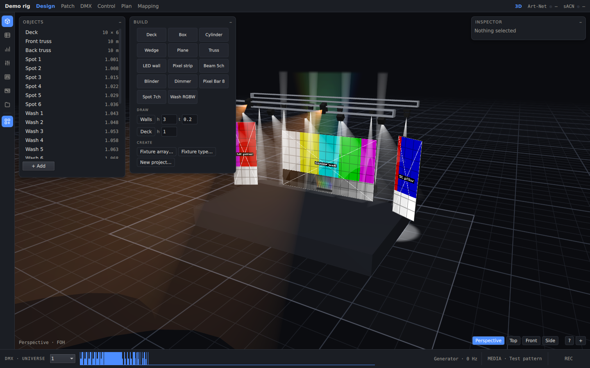

[English](../en/building-a-rig.md) · **Polski** · [Spis treści](../../README.pl.md#dokumentacja)

# Budowa sceny

## Kreator nowego projektu

**New from wizard…** (na ekranie Project) albo **New project…** (w palecie) otwiera kreator. Za jednym razem ustawia
wymiary sali, podest sceny, kratownice i pierwsze oprawy. Wszystko można później zmienić.

## Paleta

Ikona **Build** (ostatnia na pasku) otwiera paletę. Przeciągnij kafelek na scenę albo kliknij go, aby dodać obiekt na
środku.

- **Deck, Box, Cylinder, Wedge, Plane:** podesty i proste elementy scenografii.
- **Truss, LED wall, Pixel strip:** kratownica, ekran LED i taśma pikselowa.
- **Kafelki opraw** (Spot 7ch, Wash RGBW, …): po jednym na każdy typ oprawy w bibliotece.
- **DRAW:**
  - **Walls:** klikaj punkty na podłodze (w widoku z góry), aby zbudować ciąg ścian o wysokości `h` i grubości `t`.
  - **Deck:** rysuje podest o wysokości `h`.
- **CREATE:**
  - **Fixture array…:** rząd opraw z kolejnymi numerami i adresami DMX.
  - **Fixture type…:** edytor typu oprawy (opisany niżej).
  - **New project…:** kreator.

## Przesuwanie obiektów

- Zaznacz obiekt i przeciągaj kolorowe uchwyty gizmo. Przesuwają obiekt wzdłuż osi, obracają go wokół osi Y albo
  skalują.
  - Przyciąganie: 0,25 m, 5° i 0,05.
  - Z wciśniętym Alt ruch jest swobodny.
- Z klawiatury (układ Blender):
  1. Naciśnij G, aby przesunąć, R, aby obrócić, albo S, aby skalować.
  2. Opcjonalnie naciśnij X, Y lub Z, aby zablokować oś, i wpisz liczbę, aby podać dokładną wartość.
  3. Enter zatwierdza, Esc anuluje.
- Dokładne wartości można też wpisać w Inspectorze.
- **Podwieszanie opraw:** ustaw oprawie **Parent** na kratownicę, a będzie się razem z nią przesuwać.
- Jednostki to metry i stopnie. Oś Y wskazuje w górę, a oś Z w stronę widowni.

## Typy opraw

- Program zawiera sześć typów ogólnych: Spot 7ch, Beam 5ch, Wash RGBW, Blinder, Pixel Bar 8 i Generic Dimmer.
- **Project → IMPORT → GDTF…** (albo upuszczenie pliku `.gdtf` na okno) dodaje dowolny plik GDTF, na przykład pobrany
  z [GDTF Share](https://gdtf-share.com).
- **Fixture type…** w palecie otwiera formularz: kanały, kąt wiązki, mieszanie kolorów, koła. Zapisuje plik GDTF dla
  prostej oprawy, która nie ma jeszcze własnego pliku.
- Plik projektu zawiera wszystkie używane typy, więc na innym komputerze otworzy się tak samo.

## Sala

Sekcja **VENUE** na ekranie Project ustawia szerokość, głębokość i wysokość sali oraz minimalny haze. **Fit to
geometry** dopasowuje salę do wszystkiego, co zbudowano.

Dalej: [DMX i patch](dmx-and-patch.md)
