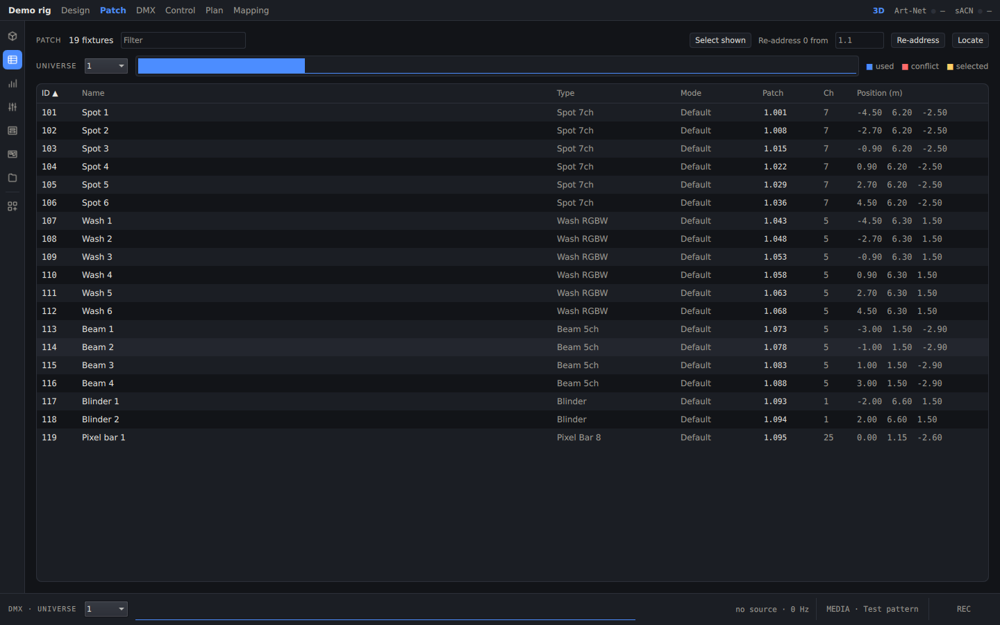
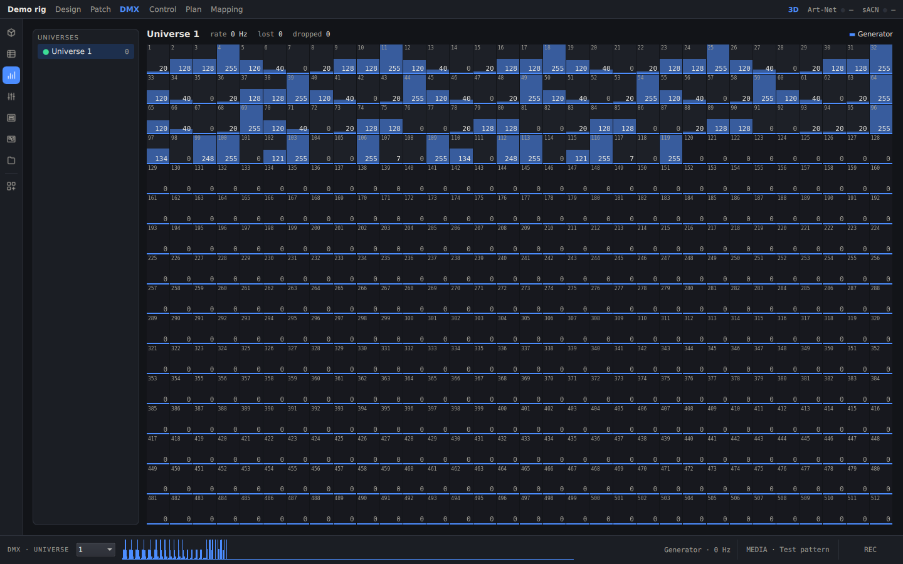
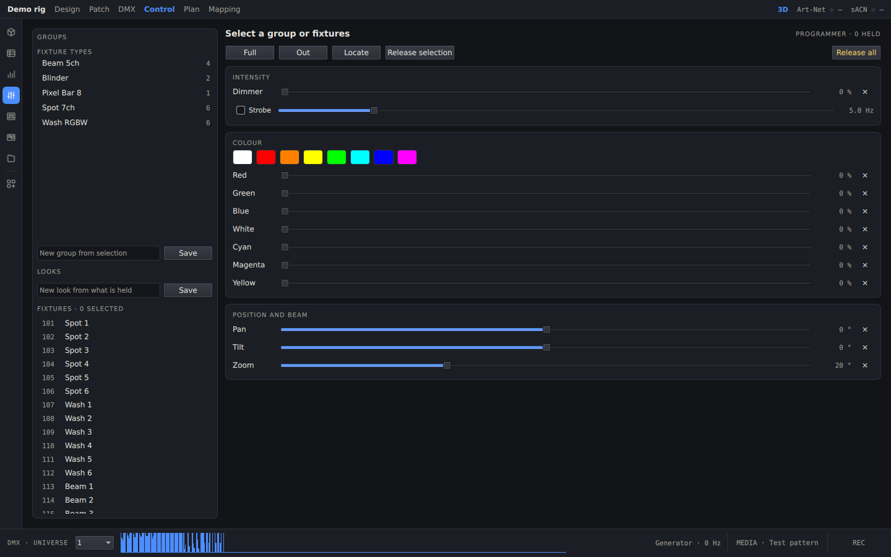

[English](../en/dmx-and-patch.md) · **Polski** · [Spis treści](../../README.pl.md#dokumentacja)

# DMX i patch

## Odbiór DMX

Scene Visualiser nasłuchuje na wszystkich interfejsach sieciowych:

| Protokół | Port | Uwagi |
|---|---|---|
| Art-Net 4 | UDP 6454 | ArtDmx, ArtSync i ArtPoll (program odpowiada, więc konsolety go wykrywają) |
| sACN E1.31 | UDP 5568 | multicast; priorytet, priorytet per adres (0xDD) i synchronizacja |

**Numeracja uniwersów:** uniwersum U w programie to uniwersum U w sACN i Port-Address U−1 w Art-Net. Uniwersum 1 to
więc Art-Net 0:0:0 i sACN 1.

Gdy kilka źródeł nadaje na to samo uniwersum, decyduje reguła łączenia (ustawiana osobno dla każdego uniwersum):
- **Priority (domyślnie):** wygrywa najwyższy priorytet. Przy remisie jasność łączy się metodą HTP, a reszta LTP.
- **HTP** albo **LTP**.

Źródło, które przestało nadawać, wygasa po 3 s (Art-Net) albo 2,5 s (sACN).

Na Windows instalator dodaje regułę zapory dla sieci prywatnych. W sieci publicznej zezwól programowi w zaporze
samodzielnie.

## Ekran Patch

- Wszystkie oprawy: numer, typ, tryb, adres (`uniwersum.adres`), liczba kanałów i pozycja.
- Pasek u góry pokazuje zajętość uniwersum: kanały zajęte, kolidujące i zaznaczone. Kolizje i przekroczenia są
  zaznaczone w tabeli.
- **Filter** zawęża listę, a **Select shown** zaznacza to, co zostało.
- **Re-address:** zaznacz oprawy, wpisz adres początkowy (`uniwersum.adres`, na przykład `2.1`) i kliknij
  **Re-address**. Oprawy są układane po kolei według numerów i przechodzą do następnego uniwersum, gdy bieżące się
  zapełni.
- **Locate** zapala zaznaczenie na pełną biel, żeby łatwo je znaleźć w rigu.

## Monitor DMX

Siatka wszystkich 512 kanałów jednego uniwersum na żywo. Lewa kolumna wymienia uniwersa z ich częstotliwością oraz
liczbą utraconych i odrzuconych pakietów.

## Ekran Control (programer)

Steruj rigiem bez konsolety:
1. Wybierz po lewej oprawy, grupę albo typ oprawy.
2. Użyj przycisków **Full**, **Out** i **Locate** albo przesuwaj suwaki: jasność i strobo, kolor (z gotowymi
   próbkami), pan, tilt i zoom.
   - Przy oprawach wielogłowicowych przyciski **HEAD** wybierają jedną głowicę.
   - **×** obok suwaka zwalnia ten parametr.

- Wartości są trzymane ponad przychodzącym DMX (pasek tytułu pokazuje **PROG**).
- **Release selection** i **Release all** oddają sterowanie.
- **GROUPS:** wpisz nazwę i kliknij **Save**, aby zapisać zaznaczenie.
- **LOOKS:** **Save** zapisuje wszystko, co jest trzymane. Kliknięcie looka go przywołuje.

## Wysyłanie DMX

**SIGNAL OUTPUT** na ekranie Project wysyła wynik końcowy (wejście, odtwarzanie i programer):
- **Send DMX** przez Art-Net lub sACN na podany adres (puste pole oznacza broadcast lub multicast).
- **Universe +** przesuwa numerację wysyłanych uniwersów.

Pozwala to sterować prawdziwym rigiem z nagrania albo z programera. **Send Resolume outputs as NDI** publikuje każde
wyjście jako źródło NDI o nazwie `SV <wyjście>`.

## Źródło testowe

Do prób konsoleta nie jest potrzebna. Uruchom program z `--generator rainbow|chase|sweep|full`, aby włączyć
wbudowany wzór, albo w kopii repozytorium uruchom
`python3 tools/dmx_send.py --proto sacn --universes 1-4 --pattern chase`.

Dalej: [Wideo i mapowanie](video-and-mapping.md)
